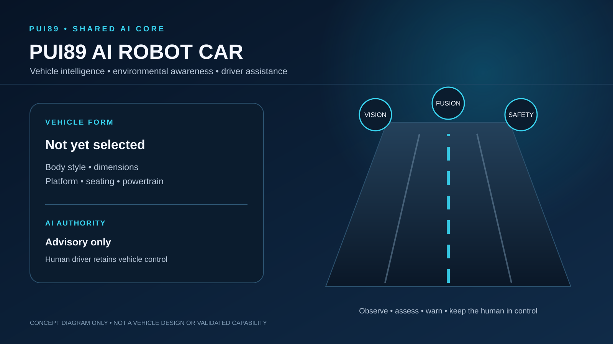
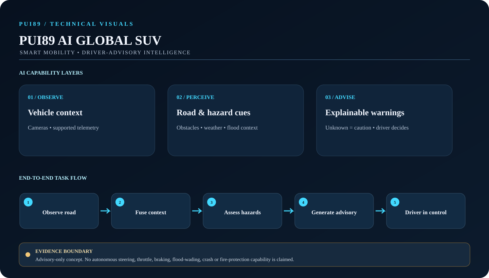

# PUI89 AI Global SUV

**ภาษาไทย:** [อ่าน README ภาษาไทย](README.th.md)

## Product and AI system update — 18 November 2026

**Public product summary (EN):** PUI89 AI Global SUV is a medium-size, five-door SUV concept with a software-first, driver-centred AI architecture. HEV is the preferred first powertrain research direction; no production vehicle, donor platform or drivetrain has been selected.

**เทคโนโลยีและประโยชน์ (TH):** แนวคิด SUV ขนาดกลาง 5 ประตู ใช้ AI ช่วยผู้ขับขี่รับรู้สภาพถนน ผู้ใช้ถนน สิ่งกีดขวาง สภาพอากาศ น้ำบนถนน และข้อมูลความเสี่ยงน้ำท่วมจากแหล่งที่ตรวจสอบได้ รวมถึงข้อมูลสุขภาพรถผ่านช่องทางอ่านอย่างเดียว ช่วยเตือนและเสนอทางเลือก แต่ผู้ขับขี่ยังคงควบคุมรถเอง

**AI technology direction:** computer vision and object tracking; GNSS/IMU; read-only OBD-II or supported vehicle telemetry; edge AI; sensor fusion; map/weather context; uncertainty-aware hazard assessment; route-avoidance advice and driver alerts. The AI Core remains independent of propulsion type.

**Who it serves:** families, everyday drivers, fleet operators and mobility partners interested in additional driver awareness and evidence-based vehicle information.

**Safety boundary:** advisory-only. No autonomous steering, throttle, braking or propulsion. If flood depth, current, road condition or passability is unknown, the system must say “unknown — do not enter.” No flood-wading, waterproofing, crashworthiness, fire protection, production readiness or global regulatory certification is claimed.

**Project website:** [English](https://pui89.github.io/ai-global-suv.html) · [ภาษาไทย](https://pui89.github.io/ai-global-suv-th.html) · [PUI89 portfolio](https://pui89.github.io/)

---

*Concept artwork only. It is not production CAD, a selected vehicle platform, a functioning prototype, or proof of flood, fire, crash, or autonomous-driving capability.*

## Product at a glance

## Latest Product Capability Baseline — 18 November 2026

**Capability lifecycle:** Perceive → Understand → Predict → Decide → Act. The following is the product-specific target capability map. Shared AI Core provides reusable foundations; each product selects sensors and functions appropriate to its mission.

### Perception and sensory intelligence

- Surrounding road-user/object awareness, lane/road context and obstacle perception using reviewed camera/radar/depth options.

- Weather, visibility, road-surface, water-on-road and flood-risk context; unknown depth or uncertain route means warn/avoid, never infer safe wading.

- Vehicle-health observations from approved read-only interfaces: battery, thermal, electrical, tyre and vibration indicators where available.

- Cabin sound/occupant interaction and environmental monitoring only within driver-distraction and privacy constraints.

### Understanding, prediction and driver assistance

- Multimodal road-context fusion, hazard prioritisation, route-risk explanation and driver-facing alerts.

- Predictive maintenance research using validated vehicle telemetry and model-specific baselines.

- Simulation/digital-twin analysis for sensor placement, scenarios, compute budgets and failure cases.

- HEV-first, powertrain-neutral AI architecture; no dependence on one engine or battery configuration.

### Safety, compute and human authority

- Edge/heterogeneous compute coordination, model sizing and graceful fallback as design goals.

- Sensor health, uncertainty, data freshness and evidence logging.

- Advisory-only: no AI autonomous steering, throttle, braking or propulsion commands; driver remains in control.

### ภาษาไทย — ความสามารถและแนวทางพัฒนา

- รับรู้รถ ผู้ใช้ถนน สิ่งของ เส้นทาง ช่องทางจราจร และสิ่งกีดขวางด้วยแนวทางกล้อง เรดาร์ หรือ Depth ที่ผ่านการพิจารณา

- วิเคราะห์สภาพอากาศ ทัศนวิสัย พื้นผิวถนน น้ำบนถนน และบริบทความเสี่ยงน้ำท่วม หากไม่ทราบระดับน้ำหรือความปลอดภัยของเส้นทางให้เตือนและหลีกเลี่ยง ห้ามอนุมานว่าลุยน้ำได้

- ตรวจสอบข้อมูลสุขภาพรถผ่านช่องทางอ่านอย่างเดียว เช่น แบตเตอรี่ ความร้อน ระบบไฟฟ้า ยาง และแรงสั่น เมื่อรถเปิดให้เข้าถึงข้อมูล

- รองรับเสียงและการโต้ตอบในห้องโดยสารภายใต้ข้อจำกัดด้านสมาธิผู้ขับขี่และความเป็นส่วนตัว

- รวมข้อมูลหลายรูปแบบ จัดลำดับความเสี่ยง อธิบายบริบทเส้นทาง และแจ้งเตือนผู้ขับขี่

- ศึกษา Predictive Maintenance จากข้อมูล telemetry ที่ตรวจสอบแล้วและค่าพื้นฐานเฉพาะรุ่น

- ใช้ Simulation/Digital Twin ศึกษาตำแหน่งเซนเซอร์ สถานการณ์ งบประมวลผล และกรณีขัดข้อง

- ออกแบบ AI แบบ HEV-first และไม่ผูกกับระบบขับเคลื่อนแบบใดแบบหนึ่ง

- พัฒนา Edge/heterogeneous compute การปรับขนาดโมเดล การตรวจสุขภาพเซนเซอร์ และการบันทึกหลักฐาน

- AI ทำหน้าที่ให้คำแนะนำเท่านั้น ไม่ควบคุมพวงมาลัย คันเร่ง เบรก หรือระบบขับเคลื่อน ผู้ขับขี่ควบคุมรถเอง

**Evidence boundary / ขอบเขตหลักฐาน:** Product and AI capabilities remain concept/specification targets. No vehicle integration, road testing, flood-wading depth, ADAS certification, autonomous control or validated predictive maintenance is claimed. / ความสามารถยังเป็นเป้าหมายระดับแนวคิดและข้อกำหนด ยังไม่มีการติดตั้งในรถ ทดสอบถนน ยืนยันความลึกการลุยน้ำ รับรอง ADAS ควบคุมอัตโนมัติ หรือ Predictive Maintenance ที่ผ่านการตรวจสอบ

**Product direction:** A medium-size, five-door SUV concept with a software-first, advisory AI architecture.

**User value:** Explore driver-support intelligence for global-market mobility, with context-aware road-risk awareness and human control.

**Key capabilities and design priorities:** HEV-first powertrain research; road and weather context; flood-risk and route awareness; vehicle-health and hazard advisory concepts; driver remains in control.

**Evidence maturity:** **Implemented** — an early software-only safety and contract foundation is documented. This label describes repository software work only; it does not mean the physical vehicle is implemented.

**Portfolio status:** No numeric commercial-readiness percentage is published. See the [PUI89 Development Observatory](https://pui89.github.io/) for the current evidence label, limitations and next gate.

**Evidence boundary:** No selected vehicle platform, production vehicle, flood-wading capability or autonomous-driving function is claimed.

**Project links:** [English website](https://pui89.github.io/ai-vehicles.html) · [PUI89 portfolio](https://pui89.github.io/)  

---
**Intelligent mobility. Global-market thinking. Evidence-led safety.**

**Official product identity:** PUI89 AI Global SUV — a medium-size, five-door SUV concept developed with global-market requirements in mind.

PUI89 AI Global SUV is a software-first vehicle-intelligence research concept for a **medium-size, five-door SUV**. The design direction prioritizes practical passenger and cargo space, all-weather usability, global-market adaptability and risk-aware driver support. It is not a small city car.

## Product direction

| Dimension | Current direction | Evidence boundary |
|---|---|---|
| Official project name | **PUI89 AI Global SUV** | Confirmed project identity |
| Vehicle class | Medium-size SUV, five-door | Design direction; no production vehicle selected |
| Initial powertrain study | **HEV-first** (full hybrid preferred for initial evaluation) | No supplier, drivetrain or vehicle platform selected |
| AI architecture | PUI89 Shared AI Core | Software-first; advisory only |
| Market intent | Global-market requirements and regional adaptation | No market homologation or regulatory compliance claimed |
| Environment | Flood-risk awareness, route avoidance, all-weather hazard context | No flood wading, waterproofing or fire-resistance capability claimed |
| Human authority | Human driver retains control | No autonomous steering, throttle, braking or propulsion |

## HEV-first, powertrain-neutral AI

Full Hybrid (HEV) is the preferred first powertrain architecture to study. It offers electric-motor assistance without requiring routine external plug-in charging. This is a research priority, not a final drivetrain decision or a claim of fuel-economy performance.

Keep the PUI89 AI Core independent of propulsion type. Versioned, read-only vehicle-context adapters may support petrol/ICE, HEV, PHEV and BEV information without creating separate AI stacks. Compare specific vehicles and markets using verified specifications, safety ratings, service access, warranty, lifecycle cost and independent evidence. Do not treat mild hybrid (MHEV) as equivalent to full hybrid (HEV).

## Global-market engineering

The concept should be assessed against regional differences rather than assuming one configuration fits every country:

- Climate, rainfall, heat, dust, road quality and flood exposure.
- Local regulations, homologation, crash and occupant-protection requirements.
- Fuel quality and availability, charging infrastructure and energy prices.
- Service networks, spare parts, warranty support and lifecycle cost.
- Passenger ergonomics, accessibility, child-seat compatibility and cargo needs.
- Cybersecurity, privacy, data residency and connected-vehicle requirements.

No global certification, regulatory approval, supplier agreement or market launch is claimed.

## Flood-risk awareness and fire/thermal safety

The intended AI role is **awareness and avoidance**, not proving that the vehicle can drive through floodwater.

- Identify documented flood-risk context and advise route avoidance.
- If water depth, current, road condition or passability is unknown, report **“unknown — do not enter”** rather than estimating a safe depth.
- Never recommend driving through moving or rising floodwater. After suspected water ingress or submersion, do not restart or charge; arrange qualified inspection and recovery.
- Fire, smoke, battery and thermal-event information may be surfaced only when supported by documented signals. Missing signals must be shown as unavailable; no system can claim to detect every fire.
- For suspected fire or smoke, the advisory priority is occupant evacuation, moving away from the vehicle and contacting emergency services. Do not instruct occupants to fight a vehicle or traction-battery fire.
- Any future water-ingress, fire-containment, thermal-propagation or crashworthiness claim requires qualified engineering and appropriate independent physical testing.

These are design requirements and software research topics, not validated physical capabilities.

## Hardware & Materials Sourcing

PUI89 uses a traceable sourcing workflow for materials, mechanical parts, sensors, compute, power and control components. See the [bilingual Hardware & Materials Sourcing guide](https://pui89.github.io/materials.html) for the process covering exact manufacturer/model identification, Thailand and international supplier discovery, country-of-origin evidence, dated pricing and availability, lead times, shipping, compatibility checks and verification gates. Product-specific candidates are added only when supported by evidence; research candidates are not purchases or validated hardware.

### Prototype materials & cost snapshot

**Planning allowance for one research prototype: ฿13,500–69,000.** This is a preliminary estimate from the [PUI89 project-specific BOM](https://pui89.github.io/materials.html#project-boms), not a supplier quotation or verified current market price.

Software-first driver-awareness research using removable, non-invasive sensors and read-only vehicle data.

| Main item | Prototype quantity | Purpose |
|---|---:|---|
| Forward RGB camera | 1 | Road observation |
| Rear/side RGB cameras | 2 | Rear and side observation |
| GNSS receiver + IMU | 1 each | Position and motion context |
| Passive OBD-II interface | 1 | Read-only vehicle data |
| Edge compute | 1 shared | Reuse shared unit first |
| Protected power, fuses and mounts | 1 set | Safe, non-invasive installation |

**Special engineering / purchase gate:** Keep the system advisory-only and non-invasive. Do not connect to steering, throttle, braking or other vehicle actuation. Confirm camera placement, driver distraction, electrical protection, vehicle warranty and legal requirements before testing.

**Shared engineering bench (tracked separately):** approximately ฿16,500–46,000 if the existing development computer is reused. This is a portfolio-level allowance for reusable compute, one RGB-D camera, bench power supply/multimeter, two microcontroller boards and reusable tools/wiring/adapters; it is not added to each project total. Allocate each shared item once, not once per product.

**Cost status:** exact manufacturer/model, manufacturing origin, supplier, stock, lead time and dated prices remain to be verified. Freight, insurance, duty, VAT, brokerage, local delivery, custom fabrication labour and certification are not priced here; calculate Thai landed cost only from dated quotations. Quantities are for one prototype; no purchase or supplier commitment is authorised. Software-first work can continue with available computing and appropriately licensed open-source tools before hardware procurement.

## Perception & Task Intelligence (PTI)

**Role in this product:** provide driver-centred road and vehicle-context awareness for the SUV concept. PTI is the shared PUI89 perception-and-task framework; the capabilities below are intended research and evaluation tasks, not production vehicle features.

**Priority perception tasks**
- Check camera visibility, image quality, sensor availability and observation freshness.
- Detect and classify supported road users and scene elements, including vehicles, pedestrians, cyclists, road edges, lane markings and supported signs.
- Track relevant road users and estimate relative motion or distance only when suitable calibrated inputs and evaluation evidence exist.
- Interpret supported weather, visibility, road-surface and map context while preserving unknown or conflicting information.
- Fuse authorised read-only sensor/vehicle observations with timestamps, units, provenance and uncertainty.
- Generate explainable driver advisories for potentially hazardous or uncertain situations; abstain when evidence is insufficient.

**Task flow:** OBSERVE → PERCEIVE → ASSESS → DECIDE → RESPOND → LEARN FROM EVIDENCE. The output is advisory information for a human driver. It is not a vehicle-control command.

**First evidence gate:** permission-cleared road-scene datasets, defined classes and operating context, held-out evaluation, missed/false detection analysis, uncertainty and stale-data tests, alert-usability review, and measured resource use on the intended compute target.

**Not established:** road-tested perception, production automotive capability, autonomous driving, collision prevention, automatic steering/throttle/braking, or validated flood-wading ability. The driver remains in control; no PTI actuation path is authorised. See the [shared PTI specification](https://github.com/Pui89/PUI89-Shared-AI-Core/blob/main/docs/perception/PUI89_PERCEPTION_TASK_INTELLIGENCE_V1.0.md) (maintainer repository access required).

## Six Core Intelligence Groups — Product Allocation

PUI89 uses six shared intelligence groups across its six active products. This product allocation is a target architecture and capability map; it does not claim that every model, sensor, integration or physical function is implemented or validated.

- Vision Intelligence — image/video understanding, detection, classification, segmentation, tracking, depth and spatial cues.
- Audio Intelligence — speech recognition, sound/event perception, speaker diarisation where justified, audio-visual association, acoustic diagnostics and speech response.
- Multimodal Intelligence — context-aware fusion of vision, audio, text, video and authorised sensor/time-series data with provenance and uncertainty.
- Robotics Intelligence — robot/environment understanding, localisation, navigation, motion planning and manipulation where the product has suitable hardware.
- Action & Reaction Intelligence — task planning, bounded proposals, event response, prediction, recovery and escalation.
- Safety & Control Intelligence — independent permissions, operating limits, verification, human approval, fault handling, safe hold and emergency-stop boundaries.

### PUI89 AI Global SUV capability allocation

- **Vision:** Road users, lanes, signs, road edges, cabin occupancy and hazard cues.
- **Audio:** Cabin speech assistant, sirens/horns, alerts and acoustic vehicle diagnostics.
- **Multimodal:** Camera/radar/vehicle signals/audio/weather/navigation context fusion.
- **Robotics:** Driver-facing route, energy and hazard advisory planning only.
- **Action & Reaction:** Collision-risk, road-hazard, flood-route and vehicle-anomaly alerts.
- **Safety & Control:** Human driver retains steering/throttle/braking; advisory-only and fail-silent.

**Integration rule:** each product uses only the modules justified by its mission, data rights, hardware, compute budget and validation evidence. Model outputs remain observations or bounded proposals. Safety policy is product-specific and independent of model confidence. Unknown, stale, conflicting or out-of-scope inputs must be surfaced rather than guessed.

**Evidence status:** proposed capability allocation unless a separate implementation record, reproducible test or domain-specific validation explicitly says otherwise. Audio models, speaker diarisation, sound classifiers, VLM/VLA policies and robotics stacks require separate provenance, licence, compute, privacy and suitability review before adoption. No automatic model download or installation is authorised.

### Six-intelligence concept visual

*Concept diagram only: it illustrates intended software intelligence domains, not a built product, installed model stack, integrated sensor suite or validated capability.*

## PUI89 Shared AI Core

Use the shared contracts and evidence boundaries:

- **Observation** — source, modality, timestamp, quality and provenance.
- **WorldState** — interpreted context, uncertainty, freshness and explicit unknowns.
- **ActionProposal** — advisory recommendation, rationale, evidence and authority boundary.
- **FailureReport** — failure mode, severity, evidence, containment and recovery information.

The AI may provide route-risk warnings, road/weather context, vehicle-health observations and explainable driver assistance. It must not command steering, throttle, braking, propulsion, high-voltage isolation or battery management.

## Development status

**Stage:** Early software and research foundation.

Existing repository materials include a deterministic signal-to-advisory baseline, initial Shared AI Core serialization adapter, synthetic contract fixtures, safety documentation and a proposed 24-module catalogue. These do not establish a functioning vehicle, validated perception model, vehicle integration, road testing or certification.

### Next engineering gates

1. Align adapter contracts with the canonical PUI89 Shared AI Core and retain conformance evidence.
2. Define medium-size SUV user, packaging, passenger, cargo and global-market requirements without presenting targets as specifications.
3. Build synthetic flood-risk, fast-moving-water, unknown-depth, smoke, thermal-event and sensor-failure scenarios.
4. Evaluate transparent baselines, false alerts, missed hazards, stale-data rejection and uncertainty behaviour.
5. Complete qualified automotive, hybrid-powertrain, battery, fire-safety, cybersecurity and regulatory reviews before any hardware integration.

## Repository map

- `docs/PROJECT_PLAN.md` — product direction and staged roadmap.
- `docs/AI_ARCHITECTURE.md` — software architecture and shared contracts.
- `docs/MASTER_ENGINEERING_SPEC_V2.md` — engineering requirements and open design decisions.
- `docs/AI_CAR_MODULE_CATALOG.md` — proposed vehicle-intelligence modules.
- `docs/SAFETY_CASE.md` — hazards, safeguards and release gates.
- `docs/THREAT_MODEL.md` and `SECURITY.md` — security risks and reporting.
- `docs/IMPLEMENTATION_STATUS.md` — implemented, missing and next work.
- `docs/AI_BENCHMARKS.md` — reproducible evaluation protocol.
- `pui89_car/` — software-only compatibility and advisory prototype.
- `tests/` — dependency-free tests and synthetic fixtures.

## Open-source-first and responsible engineering

PUI89 prioritises open-source software, transparent licensing, reproducible workflows and evidence-led collaboration. Review model, dataset, dependency and asset provenance, licences, security and hardware requirements before adoption. Do not automatically download models or install large tools. No paid APIs, metered cloud GPUs or paid subscriptions are part of the default workflow.

## Current truth and limitations

This repository is a research and software foundation. It does **not** contain a functioning SUV, selected production platform, validated drivetrain, verified sensor layout, production CAD/BOM, real-world flood or fire protection, autonomous-driving capability, road test or certified safety system. Concept art is illustrative only. All physical capabilities remain subject to engineering and independent validation.

## Project links

- [English project page](https://pui89.github.io/ai-global-suv.html)
- [Thai project page](https://pui89.github.io/ai-global-suv-th.html)
- [PUI89 portfolio](https://pui89.github.io/)
- [Website source](https://github.com/Pui89/Pui89.github.io)
- [PUI89 Shared AI Core](https://github.com/Pui89/PUI89-Shared-AI-Core)

## License

Apache License 2.0. See [LICENSE](LICENSE). Third-party images, datasets, model weights, trademarks and other assets retain their own terms and licences.

---

## Preliminary Prototype Cost Estimate (15 November 2026)

**Indicative one-unit engineering prototype planning range: ฿100,000–฿350,000 (THB).**

**Included at a planning level:** An AI compute and sensor-integration prototype using an existing compatible test vehicle or bench rig. Purchase of a donor SUV and vehicle certification are excluded.

**Estimate status:** preliminary internal planning estimate only; not a supplier quotation, purchase commitment, verified bill of materials, fixed project budget or claim that a prototype exists. The range depends on final requirements, component selection, non-Chinese-origin supplier availability, compatibility, import/shipping costs and test scope. Obtain current written quotations and verify country of manufacture/origin, exact model/part number, specifications, warranty and lead time before any procurement.

**Generally excluded:** engineering labour, research salaries, facilities, taxes/VAT, import duties, shipping unless stated in a supplier quotation, certification/regulatory approvals, production tooling, mass production, long-term maintenance and contingency. Project-specific exclusions: purchase of a donor vehicle, major vehicle modifications and road-vehicle certification.

**Lower-cost development path:** continue software-first development, open-source tools and simulation before purchasing physical hardware. Shared AI Core software and reusable development equipment may reduce duplicated costs; savings are not yet quantified. No purchase or installation is authorised by this estimate.

### Prototype hardware, materials and component budget breakdown

**Planning scope:** one engineering prototype; total planning range remains **฿100,000–฿350,000 THB**. The following subsystem allowances are preliminary engineering estimates, not supplier quotes. Individual ranges are not a promise of purchase price and must be reconciled against exact selected parts and written quotations before procurement.

| Subsystem / component type | Qty per prototype | Material / specification and function | Indicative allowance (THB) |
|---|---:|---|---:|
| Front / rear / side RGB cameras | 3–4 cameras | Road-scene coverage; lens, low-light performance and mounting reviewed per field of view | ฿20,000–฿65,000 |
| Edge compute + storage | 1 set | CPU/GPU/NPU computer sized by offline perception benchmark; no cloud dependency | ฿20,000–฿80,000 |
| GNSS + IMU | 1 set | Positioning and motion context; antenna placement and calibration | ฿8,000–฿25,000 |
| Read-only OBD-II / CAN interface | 1 isolated interface | Read-only vehicle telemetry; no command path to steering, throttle or braking | ฿3,000–฿12,000 |
| Power conditioning + fuse protection | 1 set | Automotive input protection, DC/DC, fusing, transient protection and isolation | ฿8,000–฿25,000 |
| Mounts, harness + enclosure | 1 set | Non-obstructive removable mounts, strain relief, vibration isolation and thermal enclosure | ฿10,000–฿35,000 |
| Storage / networking / display | 1 set | Local storage, status display and wired/wireless data links | ฿6,000–฿20,000 |
| Installation, calibration + closed-course tests | 1 lot | Vehicle-off installation checks, camera alignment and supervised advisory-only testing | ฿25,000–฿88,000 |

**Material families:** aluminium alloy or stainless-steel structural members where suitable; engineering polymer covers; corrosion-resistant fasteners; rated cables/connectors; protective enclosures; and product-specific seals, guards or vibration isolation. Exact alloy/grade, IP rating, load rating and country of manufacture remain unselected until engineering calculations and supplier evidence are available.

**Shared hardware accounting:** Shared AI Core software is not a product BOM. Reusable development computers, cameras or bench instruments must be listed as shared assets and allocated once; do not duplicate their full purchase cost across all six active products. Product-specific mounts, wiring, protection and integration remain in each product allowance.

**Sourcing controls:** prefer non-Chinese-origin candidates only when the exact manufacturing origin is evidenced. Record legal manufacturer, brand, exact model/part number, manufacturing country, evidence URL/document, authorised supplier, dated price/currency, stock, MOQ, lead time, warranty and landed-cost assumptions. Brand headquarters or seller location is not proof of manufacturing origin. Unknown origin = **UNVERIFIED**.

**Prototype boundary:** the allowance is for a controlled engineering prototype, not a certified commercial product or production-ready system. It excludes labour, research salaries, facilities, VAT/tax, import duties, freight/insurance unless explicitly quoted, certification, production tooling, mass production, maintenance and contingency. No purchase, download, installation or supplier commitment is authorised by this documentation.

## Shared Interaction Intelligence — PUI89 AI Global SUV

The proposed driver-assistance interaction profile may provide:

- Voice requests for navigation, route context and vehicle-information explanations.
- Concise spoken hazard and system-status alerts.
- Thai/English speech input and output where supported and validated for the target market.
- Hands-free interaction designed to minimise driver distraction.

**Driver authority:** voice is an information interface only. It must not issue autonomous steering, throttle, braking or propulsion commands. Safety-critical alerts must be prioritised, understandable and tested for distraction; the human driver retains control.

**Recommended model candidates for AI Global SUV (not approved or integrated):**

| Model/tool | Role in SUV interaction | Status |
|---|---|---|
| [openai/whisper-small](https://huggingface.co/openai/whisper-small) | Speech-to-text for limited navigation/context requests; requires in-cabin noise and distraction evaluation | PENDING_REVIEW |
| [hexgrad/Kokoro-82M](https://huggingface.co/hexgrad/Kokoro-82M) | English spoken navigation/status prompts; Thai TTS is not established | PENDING_REVIEW |
| [Silero VAD](https://github.com/snakers4/silero-vad) | Speech-segment detection; evaluate false triggers and in-cabin noise | PENDING_REVIEW |

Use short, low-distraction prompts and physical controls. Do not enable complex dialogue while driving. These candidates cannot issue steering, throttle, braking or propulsion commands. Thai speech generation remains an open candidate-research task.

**Maturity:** proposed capability only. No interaction model or in-vehicle voice integration is claimed as implemented or validated.

## World-Class Engineering Standard v1.0

This product follows the proposed [PUI89 World-Class Engineering Standard v1.0](https://github.com/Pui89/Pui89.github.io/blob/main/docs/PUI89_WORLD_CLASS_ENGINEERING_STANDARD_V1.0.md), alongside the [PUI89 Simple, Safe & Professional Engineering Standard](https://github.com/Pui89/Pui89.github.io/blob/main/docs/PUI89_SIMPLE_SAFE_PROFESSIONAL_STANDARD.md). The shared standard defines requirements traceability, Shared AI Core contracts, PTI evaluation, simulation, safety, hardware provenance, cost engineering, verification and release gates. Product capabilities remain subject to their stated evidence and validation boundaries; this reference does not imply that a gate has been passed.

## PUI89 Technical Visual — AI workflow

*Advisory-only concept. No autonomous steering, throttle, braking, flood-wading, crash or fire-protection capability is claimed.*

This diagram follows the [PUI89 Technical Visual Standard v1.0](https://github.com/Pui89/PUI89-Shared-AI-Core/blob/main/docs/PUI89_TECHNICAL_VISUAL_STANDARD_V1.0.md). It explains the proposed product-specific AI workflow and does not imply unverified implementation or physical capability.

## Automotive AI Compute & Sensor Architecture v1.0

The Global SUV has a product-specific engineering architecture covering staged automotive compute, sensor strategy, read-only vehicle-data boundaries, driver-distraction controls, test gates and evidence requirements. It is a proposed research architecture only; no vehicle integration or validation is claimed. See [SUV Automotive AI Compute & Sensor Architecture v1.0](docs/SUV_AUTOMOTIVE_AI_COMPUTE_AND_SENSOR_ARCHITECTURE_V1.0.md).
