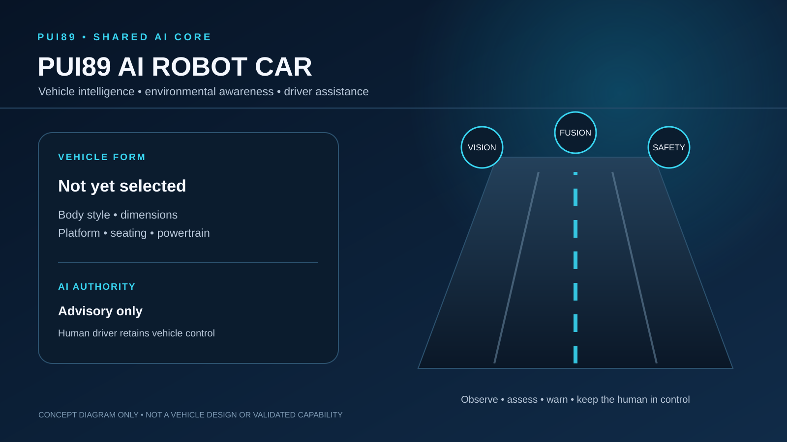

# PUI89 AI Global SUV

**แนวคิดรถ SUV สำหรับตลาดโลกที่พัฒนาบนสถาปัตยกรรม Vehicle Intelligence ของ PUI89 โดยคำนึงถึงความปลอดภัยที่มีมนุษย์เป็นศูนย์กลางและการพัฒนาที่อ้างอิงหลักฐาน**

[English](README.md) · [ภาษาไทย](README.th.md) · [เว็บไซต์ภาษาอังกฤษ](https://pui89.github.io/ai-global-suv.html) · [เว็บไซต์ภาษาไทย](https://pui89.github.io/ai-global-suv-th.html) · [PUI89 Portfolio](https://pui89.github.io/)

*ภาพแนวคิดเท่านั้น ไม่ใช่รถผลิตจริง แพลตฟอร์มที่เลือกแล้ว หรือต้นแบบที่ใช้งานได้*

## ปรัชญาการออกแบบและคำมั่นด้านประสบการณ์ลูกค้า PUI89

> **Easy to Engineer. Easy to Use. Loved by Customers.**
>
> **ขับง่าย นุ่มนวล และหรูหรา พร้อมสมรรถนะที่ยอดเยี่ยม**

ประสบการณ์ของลูกค้าเป็นข้อกำหนดหลักในการออกแบบ ไม่ใช่เพียงข้อความทางการตลาด โดย SUV ต้องพัฒนาตามหลักการต่อไปนี้
- **ขับง่าย:** การควบคุมเข้าใจง่าย ทัศนวิสัยดี ตำแหน่งผู้ขับขี่เหมาะสม การทรงตัวคาดการณ์ได้ และจอด/ขับในพื้นที่จำกัดได้สะดวก
- **นุ่มนวล:** ศึกษาการส่งกำลัง Full HEV ที่ต่อเนื่อง ลดเสียงและแรงสั่นสะเทือน ช่วงล่างให้ความสบาย เบรกและอัตราเร่งราบรื่น และระบบปรับอากาศมีประสิทธิภาพ
- **หรูหรา:** ห้องโดยสารกว้าง เบาะรองรับสรีระ วัสดุทนทานที่ให้สัมผัสพรีเมียม ห้องโดยสารเงียบ พื้นที่จัดเก็บใช้งานได้จริง งานประกอบประณีต และหน้าจอ/ระบบควบคุมที่ใช้งานง่าย
- **สมรรถนะ:** กำหนดเป้าหมายที่วัดผลได้ด้านอัตราเร่ง การเบรก การควบคุมรถ ความนุ่มนวล ประสิทธิภาพพลังงาน การจัดการความร้อน ความทนทาน และการใช้งานทุกสภาพอากาศ หลังจากศึกษาความต้องการและผลิตภัณฑ์อ้างอิง
- **วิศวกรรมที่เข้าใจง่าย:** สถาปัตยกรรมระบบชัดเจน อินเทอร์เฟซควบคุมได้ ตรวจสอบย้อนกลับข้อกำหนดได้ มีแบบวิศวกรรม/BOM ครบถ้วน ระบบวินิจฉัยและคู่มือซ่อมบำรุง และออกแบบให้เปลี่ยนโมดูลได้เมื่อเหมาะสม

**เป้าหมายทางธุรกิจ:** พัฒนาผลิตภัณฑ์ที่ลูกค้าเลือกซื้อและแนะนำต่อ มีโอกาสแข่งขันสู่การเป็นสินค้าขายดีในกลุ่มเป้าหมาย และมีเศรษฐศาสตร์ต่อหน่วยที่เป็นบวก ทั้งหมดเป็นความมุ่งหมาย ไม่ใช่การคาดการณ์หรือรับประกันยอดขาย ต้องตรวจสอบราคา กำไร ความต้องการตลาด และต้นทุนบริการกับลูกค้า ซัพพลายเออร์ และพันธมิตรการผลิต

**ขอบเขตหลักฐาน:** ข้อความนี้เป็นเป้าหมายการออกแบบและธุรกิจ ยังไม่ใช่หลักฐานว่ามีรถที่สร้างเสร็จ ผ่านการทดสอบการขับขี่ มีคุณภาพหรูหราที่ตรวจสอบแล้ว มีต้นทุนผลิต ความพึงพอใจ ความต้องการตลาด หรือกำไรจริง รวมถึงยังไม่ใช่การอนุมัติตามกฎหมายหรืออนุญาตผลิตจำนวนมาก ทุกข้อกล่าวอ้างต้องมีการทดสอบและหลักฐานที่ตรวจสอบได้

## มาตรฐานภาพ หลักฐาน และใบอนุญาต

**ภาพอ้างอิงจากโลกจริง:** ใช้ภาพเทคโนโลยียานยนต์ ชิ้นส่วนรถผลิตจริง เซนเซอร์ช่วยขับขี่ ระบบความปลอดภัย กระบวนการผลิต และสภาพถนน โดยระบุผู้ผลิต/รุ่นเมื่อเกี่ยวข้อง ภาพเหล่านี้เป็นข้อมูลเปรียบเทียบ ไม่ใช่เทคโนโลยีของ PUI89 หรือหลักฐานการตรวจสอบผลิตภัณฑ์

**ภาพแนวคิด PUI89:** ภาพ SUV เป็นทิศทางการออกแบบที่เสนอ ไม่ใช่รถผลิตจริง แพลตฟอร์มต้นแบบที่เลือกแล้ว รถที่ได้รับอนุญาตให้ใช้บนถนน หรือต้นแบบที่ทำงานได้

**คำอธิบายหลักฐาน:** แยกภาพอ้างอิงจากผู้ผลิต ภาพแนวคิด PUI89 ภาพจำลอง และหลักฐานทดสอบจริง ห้ามกล่าวอ้างคะแนนทดสอบการชน ประสิทธิภาพ ADAS ความถูกต้องตามกฎหมาย ระยะทางขับขี่ หรือความพร้อมผลิต หากไม่มีหลักฐานที่เชื่อถือได้

**แหล่งที่มาและใบอนุญาต:** แนะนำ [Wikimedia Commons](https://commons.wikimedia.org/) และ [Pexels](https://www.pexels.com/) บันทึกหน้าแหล่งที่มา ผู้สร้าง URL ไฟล์ ใบอนุญาต เครดิต วันที่เข้าถึง และการดัดแปลง ตรวจสอบข้อจำกัดเครื่องหมายการค้า สิทธิภาพบุคคล การใช้เชิงพาณิชย์ และงานดัดแปลงก่อนเผยแพร่

## 1. ผลิตภัณฑ์นี้คืออะไร

PUI89 AI Global SUV เป็นโครงการแนวคิดรถ SUV ขนาดกลาง 5 ประตู มุ่งพัฒนาการออกแบบและสถาปัตยกรรมวิศวกรรมของ PUI89 เอง โดยศึกษาแนวทางอุตสาหกรรมในด้านความปลอดภัย ความหรูหรา วิศวกรรมระบบ และยานยนต์ที่ขับเคลื่อนด้วยซอฟต์แวร์ การศึกษาเหล่านี้เป็น Benchmark เท่านั้น ไม่ใช่การคัดลอกเทคโนโลยีหรือแบบที่มีกรรมสิทธิ์

## 2. ภารกิจและขอบเขตหน้าที่

มุ่งสู่รถ SUV สำหรับการเดินทางประจำวันและครอบครัว ใช้งานในเมือง ทางหลวง และสภาพถนนภูมิภาค โดยตลาดเป้าหมายและขอบเขตการใช้งานยังต้องผ่านการศึกษาข้อกำหนดอย่างเป็นทางการ

## 3. ผู้ใช้งานและคุณค่าที่มุ่งส่งมอบ

ผู้ขับขี่และผู้โดยสารที่ต้องการรถ SUV ใช้งานได้จริง พร้อมระบบ AI ให้ข้อมูลและคำเตือนประกอบการตัดสินใจ โดยผู้ขับขี่ยังคงควบคุมรถทั้งหมด

## 4. ความสามารถเฉพาะผลิตภัณฑ์ภายใต้การวิจัย

- การรับรู้สภาพถนน ผู้ใช้ถนน สิ่งกีดขวาง ช่องทางจราจร ป้าย และทัศนวิสัย เมื่อมีเซนเซอร์ที่ผ่านการตรวจสอบ
- บริบทสภาพอากาศ พื้นผิวถนน และน้ำบนถนน พร้อมคำแนะนำความเสี่ยงเส้นทางอย่างระมัดระวัง
- การอ่านสถานะสุขภาพรถและข้อมูลวินิจฉัยผ่านอินเทอร์เฟซที่ได้รับอนุญาตและตรวจสอบแล้วเท่านั้น
- คำเตือนที่อธิบายเหตุผลได้ ประวัติเหตุการณ์ในเครื่อง และรายงานสุขภาพเซนเซอร์
- การประมวลผลในเครื่องและการจัดสรรงานให้ CPU/GPU/NPU/MCU อย่างเหมาะสม เป็นเป้าหมายการวิจัย ไม่ใช่ความสามารถที่ติดตั้งแล้ว

## 5. AI และสถาปัตยกรรมความฉลาด

แนวทางประกอบด้วย Vehicle Intelligence, Multimodal Perception, Sensor Fusion, Edge AI, การจัดสรรทรัพยากรคอมพิวต์แบบ heterogeneous และการลดระดับการทำงานอย่างปลอดภัย ความสามารถแต่ละอย่างต้องมีข้อมูลต้นทาง สถานะการสอบเทียบ เวลา ความไม่แน่นอน และหลักฐานการทดสอบ

## 6. ฮาร์ดแวร์และเซนเซอร์

ทิศทางตัวรถคือ SUV ขนาดกลาง 5 ประตู ห้องโดยสารสูงและมีพื้นที่สัมภาระท้ายรถ ภาษาการออกแบบ Deep Navy / Electric Cyan / Titanium Silver ทิศทางการศึกษาระบบขับเคลื่อนล่าสุดคือ 2.0L Full Hybrid (HEV) + RWD โดย 2.0L เป็นเป้าหมายวิจัยเบื้องต้น ยังไม่ได้เลือกรุ่นเครื่องยนต์หรือผู้ผลิต

เซนเซอร์ที่อาจศึกษา ได้แก่ RGB/Depth Camera, Radar, Ultrasonic, GNSS, IMU, เซนเซอร์สภาพอากาศ/ความร้อน และข้อมูลรถที่รองรับ รายการ ตำแหน่ง ระยะ และขอบเขตครอบคลุมยังเป็น TBD

### ระบบขับเคลื่อนและพลังงาน

ทิศทางการศึกษาระบบขับเคลื่อนล่าสุดคือ **เครื่องยนต์เบนซินเป้าหมายเบื้องต้น 2.0L + Full Hybrid (HEV) + ขับเคลื่อนล้อหลัง (RWD)** โดยยังไม่ได้เลือกรุ่นเครื่องยนต์หรือผู้ผลิต
- **สถาปัตยกรรมไฮบริด:** ศึกษาระบบ Full HEV ที่รองรับ RWD รวมถึงทางเลือก Series-Parallel โดยต้องเปรียบเทียบการจัดวาง ประสิทธิภาพ ความทนทาน ความปลอดภัย การบำรุงรักษา และต้นทุนก่อนเลือก
- **ระบบขับเคลื่อน:** RWD เป็นรูปแบบหลักที่อยู่ระหว่างศึกษา ส่วน AWD เป็นทางเลือกสำหรับรุ่นอนาคต ไม่ใช่ข้อกำหนดพื้นฐานในขณะนี้
- **แบตเตอรี่:** ศึกษาแบตเตอรี่แรงดันสูงสำหรับระบบขับเคลื่อนด้วยมอเตอร์ไฟฟ้าและคอมเพรสเซอร์แอร์ไฟฟ้า แยกจากแบตเตอรี่ 12V สำหรับระบบไฟฟ้าแรงดันต่ำ ความจุ เคมี แรงดัน และผู้ผลิตยังไม่กำหนด
- **ระบบปรับอากาศ:** ศึกษาคอมเพรสเซอร์แอร์ไฟฟ้าแรงดันสูงแบบปรับรอบได้ เครื่องยนต์อาจหยุดทำงานขณะจอดเมื่อเงื่อนไขของระบบไฮบริดเอื้ออำนวย และอาจกลับมาทำงานเมื่อพลังงานหรือภาระความร้อนต้องการ พลังงานสำหรับแอร์ไม่ใช่พลังงานฟรี โดยมาจากน้ำมัน พลังงานที่นำกลับมาใช้ หรือพลังงานที่เก็บในแบตเตอรี่
- **กรณีเปรียบเทียบ:** คง 2.5L HEV, FWD/e-AWD, รถน้ำมัน, PHEV และ BEV ไว้เป็นตัวเลือกสำหรับการศึกษาเปรียบเทียบ ไม่ใช่แนวทางหลักล่าสุด
- ยังไม่มีการเลือกรุ่นเครื่องยนต์ รูปแบบมอเตอร์ ระบบส่งกำลัง เคมี/ความจุแบตเตอรี่ ผู้จัดจำหน่าย แพลตฟอร์ม อัตราสิ้นเปลือง ระยะทาง การปล่อยมลพิษ หรือสมรรถนะ

## 7. ความปลอดภัย ความเป็นส่วนตัว และความมั่นคงปลอดภัย

- ผู้ขับขี่ควบคุมพวงมาลัย คันเร่ง เบรก และระบบขับเคลื่อนตลอดเวลา
- AI ให้ข้อมูลและคำเตือนเท่านั้น ไม่มีการควบคุมการขับขี่หรือสั่งตัวขับเคลื่อนอัตโนมัติ
- ประมวลผลและจัดเก็บในเครื่องเป็นหลัก ห้ามส่งภาพห้องโดยสาร เสียง ตำแหน่ง หรือข้อมูลรถออกไปโดยไม่ได้รับอนุญาต
- หากไม่ทราบความลึก กระแสน้ำ หรือความสามารถในการผ่านน้ำ ให้ระบุว่า **ไม่ทราบ — ห้ามเข้า**
- ตรวจสอบแหล่งกำเนิด ใบอนุญาต ความปลอดภัย และความสามารถในการทดแทนผู้ขาย โดยยึดหลักไม่พึ่งพาห่วงโซ่อุปทานและเทคโนโลยีจากจีน

## ความหรูหรา การบำรุงรักษา และกลยุทธ์อะไหล่ระดับสากล

**หลักการออกแบบ: หรูหราเมื่อใช้งาน บำรุงรักษาง่าย ซ่อมได้ตั้งแต่ขั้นออกแบบ**

ทิศทางการศึกษาระบบขับเคลื่อนล่าสุดคือ 2.0L Full HEV + RWD โดย 2.0L เป็นเป้าหมายเบื้องต้นสำหรับการวิจัย ยังไม่ใช่การเลือกเครื่องยนต์จริง ส่วน 2.5L HEV และ FWD/e-AWD ยังคงเป็นกรณีศึกษาเปรียบเทียบ และอาจพิจารณา AWD เป็นรุ่นต่อยอดในอนาคต แนวทาง SUV 5 ที่นั่ง เป้าหมายน้ำหนักบรรทุก 500 kg, GVWR เป้าหมาย 2,700 kg ซึ่งต้องยืนยันทางวิศวกรรม และเป้าหมายภูมิอากาศขณะใช้งาน -40°C ถึง +50°C รวมถึงเป้าหมายท้าทายเพิ่มเติม -50°C ถึง +60°C ยังคงเป็นเป้าหมาย ไม่ใช่สเปกที่ผ่านการตรวจสอบหรือรับรองแล้ว

ความหรูหราต้องวัดผลได้ ทั้งความสบายของเบาะและห้องโดยสาร เสียงและแรงสั่นสะเทือนต่ำ ระบบทำความร้อน/ความเย็น/ไล่ฝ้าที่มีประสิทธิภาพ การควบคุมที่เข้าใจง่าย วัสดุทนทานทำความสะอาดและซ่อมได้ การป้องกันสนิม และการใช้งานในภูมิอากาศหลากหลาย

ข้อกำหนดด้านการบำรุงรักษา:
- เข้าถึงจุดตรวจและบำรุงรักษาตามปกติได้ เช่น ไส้กรอง ของเหลว ฟิวส์ รีเลย์ แบตเตอรี่แรงดันต่ำ และช่องวินิจฉัย
- ออกแบบให้เปลี่ยนโมดูลที่ซ่อมบำรุงได้ เช่น ปั๊ม พัดลม เซนเซอร์ สายไฟบางช่วง โคมไฟ สวิตช์ ชิ้นตกแต่ง และกล่องควบคุม โดยไม่รื้อชุดใหญ่เกินจำเป็น
- มีรหัสข้อผิดพลาดที่ชัดเจน ระบบวินิจฉัยแบบอ่านข้อมูลเท่านั้นสำหรับ PUI89 AI และคู่มือซ่อมที่ตรวจสอบย้อนกลับได้
- มีคู่มือช่าง แผนผังสายไฟ รายละเอียดขั้วต่อ ค่าแรงขันที่ยืนยันแล้ว ขั้นตอนปรับเทียบหลังเปลี่ยนอะไหล่ และเอกสารภาษาไทย/อังกฤษ
- งานแบตเตอรี่แรงดันสูง อินเวอร์เตอร์ และมอเตอร์ไฟฟ้าให้ทำโดยช่างที่ผ่านการฝึกอบรมตามขั้นตอนความปลอดภัยเท่านั้น
- ห้ามสร้างระยะบำรุงรักษา ค่าแรงขัน รหัสอะไหล่ หรือคำกล่าวอ้างเรื่องการใช้แทนกันได้ขึ้นเอง

กลยุทธ์อะไหล่ระดับโลก: ประเมินผู้ผลิตและเครือข่ายบริการที่มีคุณสมบัติในไทย/อาเซียน ญี่ปุ่น เกาหลีใต้ ยุโรป และสหรัฐอเมริกา ให้ความสำคัญกับมาตรฐานชิ้นส่วนที่มีข้อมูลชัดเจน เครือข่ายบริการ การสนับสนุนระยะยาว สต็อกในภูมิภาค แหล่งกำเนิดที่ตรวจสอบได้ และแหล่งจัดหาสำรองสำหรับชิ้นส่วนสำคัญ โครงการยังคงหลักการไม่พึ่งพาจีน โดยต้องตรวจสอบแหล่งกำเนิดจริง ไม่ใช้เพียงที่ตั้งสำนักงานใหญ่หรือผู้จัดจำหน่ายเป็นหลักฐาน ยังไม่มีการเลือกผู้ขายหรือรับประกันความพร้อมของอะไหล่

อ่าน [กลยุทธ์ความหรูหรา การบำรุงรักษา และอะไหล่ระดับสากล v1.0](docs/PUI89_GLOBAL_SERVICEABILITY_AND_PARTS_STRATEGY_V1.0.md)

## 8. สิ่งที่ยังไม่มีหลักฐานยืนยัน

ยังไม่มีรถผลิตจริง แพลตฟอร์มรถที่เลือก การบูรณาการกับรถ การทดสอบถนน ผลทดสอบการชน ความสามารถลุยน้ำ คะแนนความปลอดภัย หรือการรับรองตามกฎหมาย ไม่มีการอ้างว่าขับขี่อัตโนมัติหรือสามารถข้ามน้ำได้อย่างปลอดภัย

## 9. สถานะการพัฒนาและหลักฐาน

**ระยะกำหนดแนวคิดและพื้นฐานวิศวกรรมซอฟต์แวร์ระยะแรกเท่านั้น** เอกสารการออกแบบและงานซอฟต์แวร์ไม่ใช่ต้นแบบรถจริงหรือผลิตภัณฑ์ AI ที่ผ่านการตรวจสอบบนรถแล้ว

## 10. ขั้นตอนพิสูจน์ผลถัดไป

กำหนดตลาดเป้าหมายและข้อกำหนดรถ ศึกษาแพลตฟอร์มและระบบขับเคลื่อน ประเมินความเสี่ยงและเซนเซอร์ จากนั้นทดสอบซอฟต์แวร์แบบออฟไลน์และจัดทำหลักฐานก่อนพิจารณาการบูรณาการกับรถจริง

## 11. การเชื่อมต่อกับ Shared AI Core

ใช้ Shared AI Core สำหรับสถาปัตยกรรม AI แบบใช้ซ้ำ การประมวลผล Multimodal การจัดสรรทรัพยากร การจัดการหลักฐาน ความปลอดภัย ความเป็นส่วนตัว และการทำงานในเครื่อง ทั้งนี้ข้อกำหนดด้านรถยนต์และความปลอดภัยของผู้ขับขี่ต้องตรวจสอบแยกตามผลิตภัณฑ์

## 12. เอกสารและลิงก์โครงการ

- [Master Design & Engineering Blueprint v1.0](docs/PUI89_AI_GLOBAL_SUV_MASTER_DESIGN_ENGINEERING_BLUEPRINT_V1.0.md)
- [เว็บไซต์ภาษาอังกฤษ](https://pui89.github.io/ai-global-suv.html)
- [เว็บไซต์ภาษาไทย](https://pui89.github.io/ai-global-suv-th.html)
- [Repository](https://github.com/Pui89/PUI89-AI-Global-SUV)

ตัวเลขขนาด น้ำหนัก ระยะทาง ความจุ พละกำลัง และราคา ยังไม่ถือว่าได้รับอนุมัติจนกว่าจะมีข้อกำหนดและหลักฐานที่เหมาะสม

## การตรวจสอบช่องว่างการพัฒนา Vehicle AI

อ่าน [PUI89 Vehicle AI Development Gap Audit v1.0 ภาษาไทย](https://github.com/Pui89/PUI89-Shared-AI-Core/blob/main/docs/engineering/PUI89_VEHICLE_AI_DEVELOPMENT_GAP_AUDIT_V1.0.th.md) เพื่อดูสถานะ SUV/Scooter ตามหลักฐาน ช่องว่างการพัฒนา Validation Gates และลำดับการพัฒนา CPU-first พร้อม [ฉบับภาษาอังกฤษ](https://github.com/Pui89/PUI89-Shared-AI-Core/blob/main/docs/engineering/PUI89_VEHICLE_AI_DEVELOPMENT_GAP_AUDIT_V1.0.md) ผล Audit ไม่ได้หมายถึงมีการเชื่อมต่อรถหรือผ่านการทดสอบบนถนนแล้ว

## วิศวกรรมและการผลิตระดับสากล

ดู [PUI89 Global Engineering & Manufacturing Design Brief](docs/PUI89_GLOBAL_MANUFACTURING_DESIGN_BRIEF_V1.0.md) สำหรับข้อกำหนดเบื้องต้นด้านขนาด วัสดุประเภทที่อยู่ระหว่างศึกษา กลุ่มส่วนประกอบ การผลิตหลายประเทศ การทดสอบสภาพแวดล้อม และเกณฑ์การตรวจสอบ เอกสารนี้แยกเป้าหมายการออกแบบออกจากผลทดสอบจริง รายการวัสดุและส่วนประกอบยังไม่ใช่ BOM ที่อนุมัติผลิต ขนาด เกรดวัสดุ รุ่นชิ้นส่วน และค่าความคลาดเคลื่อนที่ยังไม่มีหลักฐานจะระบุเป็น TBD จนกว่าจะผ่านการวิเคราะห์และการตรวจสอบทางวิศวกรรม

## ระบบวิศวกรรมและการผลิตระดับสากล

สำหรับวิศวกร โรงงาน และผู้ปฏิบัติงานในทุกประเทศ ให้ใช้งานเอกสารควบคุมกลางของ PUI89:
- [พอร์ทัลวิศวกรรมและการผลิต PUI89](https://pui89.github.io/global-engineering.html)
- [PUI89 Global Manufacturing Handoff System v1.0](https://github.com/Pui89/Pui89.github.io/blob/main/docs/PUI89_GLOBAL_MANUFACTURING_HANDOFF_SYSTEM_V1.0.md)

**กฎการผลิต:** ซื้อ ผลิต เปลี่ยนชิ้นส่วน ตรวจสอบ หรืออนุมัติรถได้เฉพาะตาม configuration, revision, drawing, BOM และ work instruction ที่อนุมัติแล้วเท่านั้น หากข้อมูลขาดหายหรือขัดแย้ง ให้ **หยุดงาน — ห้ามเดา** และเปิด Technical Query (TQ) ชุดแบบฟอร์มการผลิตกลางกำลังตรวจสอบใน [PUI89 website PR #639](https://github.com/Pui89/Pui89.github.io/pull/639) และยังไม่ใช่เอกสารอนุญาตให้ผลิต

## หลักวิศวกรรมระยะยาว 8 ประการ

หลักการต่อไปนี้ใช้ตลอดอายุการใช้งานรถ และต้องแปลงเป็นข้อกำหนดที่ตรวจสอบย้อนกลับได้ พร้อมวิธีทดสอบ เกณฑ์ผ่าน และหลักฐานบริการที่ควบคุมเวอร์ชัน:

1. **Easy to Inspect — ตรวจสอบง่าย:** เข้าถึงจุดตรวจตามปกติ ช่องวินิจฉัย และสถานะบริการได้อย่างปลอดภัยและมีป้ายกำกับชัดเจน พร้อมทดสอบงานจริงกับช่าง
2. **Easy to Repair — ซ่อมง่าย:** ใช้โมดูลที่เปลี่ยนได้ รวมถึงชิ้นส่วนตกแต่งและสายไฟบางช่วงที่ซ่อมได้ เมื่อไม่กระทบความปลอดภัย ความทนทาน และต้นทุนตลอดอายุใช้งาน ต้องทดสอบการถอด/ติดตั้งและการทำงานหลังซ่อม
3. **Globally Serviceable — รองรับบริการระดับโลก:** ประเมินเครือข่ายบริการและอะไหล่ที่มีคุณสมบัติในไทย/อาเซียน ญี่ปุ่น เกาหลีใต้ ยุโรป และสหรัฐฯ พื้นที่เหล่านี้เป็นตลาดเป้าหมายสำหรับประเมิน ไม่ใช่การยืนยันว่ามีบริการแล้ว
4. **Parts Traceability — ตรวจสอบย้อนกลับอะไหล่:** บันทึกผู้ผลิต รหัสอะไหล่ผู้ผลิตจริง โรงงานผลิต ประเทศต้นกำเนิด แหล่งที่มาของผู้ผลิตช่วง Revision ตำแหน่งติดตั้ง และอะไหล่ทดแทนที่ผ่านการตรวจสอบ หากไม่ทราบแหล่งกำเนิดให้ถือว่ายังไม่อนุมัติ
5. **Long-Term Support — สนับสนุนระยะยาว:** วางแผนคู่มือซ่อม แผนผังสายไฟ/วินิจฉัย การฝึกอบรมช่าง การรับประกัน/เรียกคืน การสนับสนุนซอฟต์แวร์ และการจัดการชิ้นส่วนเลิกผลิตหรือเปลี่ยนรุ่น
6. **Offline Reliability — เชื่อถือได้เมื่อออฟไลน์:** ระบบควบคุมการขับขี่หลักและระบบความปลอดภัยที่จำเป็นต้องไม่พึ่งโทรศัพท์ แอป อินเทอร์เน็ต หรือคลาวด์ พร้อมช่องทางวินิจฉัยและข้อมูลบริการแบบออฟไลน์
7. **AI Maintenance Intelligence — AI ช่วยงานบำรุงรักษา:** PUI89 AI อธิบายข้อมูลวินิจฉัยแบบอ่านอย่างเดียวที่ได้รับอนุญาต วิเคราะห์แนวโน้มและความไม่แน่นอน พร้อมแนะนำการตรวจสอบได้ แต่ห้ามล้าง/ซ่อนข้อขัดข้องด้านความปลอดภัย เขียนข้อมูลไปยัง ECU ควบคุม หรือแทนที่ช่างผู้มีคุณสมบัติ
8. **Lifetime Reliability — ความเชื่อถือได้ตลอดอายุใช้งาน:** พิสูจน์ความทนทาน การบำรุงรักษา การกัดกร่อน ความร้อน การสั่นสะเทือน และการซ่อมด้วยการทดสอบซ้ำได้และหลักฐานภาคสนามที่ผูกกับรุ่น configuration ห้ามกล่าวอ้างอายุใช้งานโดยไม่มีหลักฐาน

**กฎการวัดผล:** คำว่า “ง่าย” “ทั่วโลก” “ระยะยาว” และ “เชื่อถือได้” ต้องไม่เป็นเพียงคำโฆษณา แต่ต้องมีงานหรือค่าชี้วัด เงื่อนไขทดสอบ ผู้ตรวจสอบ เกณฑ์ผ่าน และหลักฐานจัดเก็บ ไม่มีการยืนยันผู้ขาย ความพร้อมอะไหล่ เวลาในการซ่อม ระยะบำรุงรักษา หรืออายุใช้งาน จนกว่าจะตรวจสอบได้

## นโยบายเทคโนโลยีพร้อมรับอนาคต

ผลิตภัณฑ์นี้อ้างอิง [นโยบายเทคโนโลยีพร้อมรับอนาคตของ PUI89 v1.0](https://github.com/Pui89/PUI89-Shared-AI-Core/blob/main/docs/architecture/PUI89_FUTURE_READY_TECHNOLOGY_POLICY_V1.0.th.md) ซึ่งกำหนดให้ออกแบบอินเทอร์เฟซที่อัปเกรดได้ เลือกเทคโนโลยีจากหลักฐาน ตรวจสอบแหล่งที่มาและใบอนุญาต ควบคุมทรัพยากรแบบ Local-first ทดสอบความเข้ากันได้ มีระบบสำรองที่ปลอดภัย และควบคุมขอบเขตการส่งมอบ โดยติดตามเทคโนโลยีทุกเดือนและทบทวนสถาปัตยกรรมทุกไตรมาส การอ้างอิงนี้ไม่ได้ยืนยันว่ามีการสลับโมเดล Hardware Abstraction, Sensor Adapter ระบบติดตามอัตโนมัติ หรือการตรวจสอบผลิตภัณฑ์แล้ว

## แผนอัปเกรดเทคโนโลยีเฉพาะผลิตภัณฑ์

**ความสอดคล้องกับ Gartner 2026:** Physical AI, Hybrid/AI Supercomputing, Domain-Specific Models, Digital Provenance และ AI Security ดู [นโยบายกลางของ PUI89](https://github.com/Pui89/PUI89-Shared-AI-Core/blob/main/docs/architecture/PUI89_FUTURE_READY_TECHNOLOGY_POLICY_V1.0.th.md)

| ด้านที่อัปเกรด | ลำดับแผน (ยังไม่ใช่การยืนยันความสามารถ) |
|---|---|
| Advisory ADAS และ Road Perception | กำหนดขอบเขตให้คำแนะนำเท่านั้นและคงอำนาจผู้ขับขี่ ประเมินคุณภาพ Perception/Warning ด้วยข้อมูลตัวแทนที่ใช้ได้โดยชอบ พร้อมรายงานความไม่แน่นอน |
| Sensor Fusion และ Driver Monitoring | กำหนด Data Interface และประเมินส่วนประกอบแยกกัน บันทึก False Positive, การตรวจไม่พบ และสภาพระบบเสื่อมสภาพ |
| Predictive Maintenance | เริ่มจากข้อมูลรถแบบอ่านอย่างเดียวที่ตรวจสอบที่มาได้และ Diagnostics ที่อธิบายได้ ต้องมีหลักฐานก่อนกล่าวอ้างการพยากรณ์ |
| Safety และ Cybersecurity | คงระบบความปลอดภัย OEM วิเคราะห์ความเสี่ยงของ Interface/Update และห้าม AI ควบคุมพวงมาลัย คันเร่ง เบรก หรือเขียนข้อมูล ECU ที่มีผลต่อความปลอดภัย |

**Gate แรก:** กำหนดสถาปัตยกรรมและขอบเขตการเข้าถึงข้อมูล โดยเชื่อมต่อแบบอ่านอย่างเดียว/ให้คำแนะนำที่เข้ากันได้กับ OEM **สถานะ:** แผนที่เสนอเท่านั้น

## แผนวิวัฒนาการเทคโนโลยีระยะยาวและการป้องกันความล้าสมัย (2027–2030+)

แผนระยะยาวนี้ต่อยอดจากลำดับพัฒนา P1–P4 และขยายกรอบคิดจากแนวโน้มปี 2026 ไปข้างหน้า โดยเป็นช่วงเวลาสำหรับประเมิน ไม่ใช่การรับประกันความสามารถหรือกำหนดวันนำมาใช้ เทคโนโลยีทุกชนิดต้องผ่านการพิสูจน์คุณค่าต่อผู้ใช้ ที่มาและใบอนุญาต ความเหมาะสมกับฮาร์ดแวร์ ความปลอดภัย การบำรุงรักษา และหลักฐานที่ทำซ้ำได้

| ช่วงเวลา | แนวทางวิวัฒนาการของผลิตภัณฑ์ |
|---|---|
| 2027 | กำหนดอำนาจระบบให้เป็นการให้คำแนะนำเท่านั้น ขอบเขตข้อมูลรถแบบอ่านอย่างเดียว กฎความเป็นส่วนตัวของ Driver Monitoring และข้อกำหนด Interface ด้านความปลอดภัย |
| 2028 | ประเมิน Sensor Fusion จากถนน/ห้องโดยสาร และ Predictive Diagnostics ที่อธิบายได้ด้วยข้อมูลตัวแทนที่ใช้ได้โดยชอบ บันทึกการเตือนผิด การพลาดเหตุการณ์ และความไม่แน่นอน |
| 2029 | สำรวจ Context-aware Mobility Assistance, แบบจำลอง Digital Twin/สุขภาพรถ และการเชื่อมต่อ Software-defined Vehicle ที่ปลอดภัยโดยไม่ข้ามการควบคุมของ OEM |
| 2030+ | รักษาความเข้ากันได้กับรถหลายรุ่นผ่าน Read-only Adapter ที่กำหนดเวอร์ชัน ห้าม AI ควบคุมพวงมาลัย คันเร่ง เบรก หรือเขียน ECU ที่มีผลต่อความปลอดภัย |

**กฎป้องกันความล้าสมัยอย่างต่อเนื่อง:** ติดตามสัญญาณเทคโนโลยีทุกเดือน ทบทวนสถาปัตยกรรมทุกไตรมาส และทบทวน Roadmap ทั้งหมดทุกปี พร้อมทบทวนนอกกำหนดเมื่อ Dependency สำคัญหยุดสนับสนุน พบปัญหาความปลอดภัย หรือผลทดสอบเกินข้อจำกัดด้านประสิทธิภาพ/ทรัพยากร ทุกการอัปเกรดต้องมี Baseline ที่ตรวจสอบแล้ว แผน Migration/Rollback ชุดทดสอบ Compatibility/Regression และบันทึกเหตุผลการตัดสินใจ ห้ามเลือกเทคโนโลยีเพียงเพราะเป็นของใหม่ **สถานะ:** เป็นแผนที่เสนอ ยังไม่กล่าวอ้างว่าความสามารถในอนาคตถูกพัฒนาหรือ Validate แล้ว

---

## ทิศทางการวิจัยทางวิชาการ — เป้าหมายวารสาร Q1 (ข้อเสนอ)

**หัวข้อวิจัย:** Predictive Multimodal AI สำหรับการรับรู้ความเสี่ยงบนถนนและสภาพแวดล้อม  
**ชื่อบทความเบื้องต้น:** *Spatiotemporal Multimodal Risk Prediction and Uncertainty-Calibrated Driver Advisories under Changing Road and Environmental Conditions*

### ปัญหาและช่องว่าง
การตรวจจับวัตถุไม่ได้หมายความว่าจะทำนายความเสี่ยงต่อรถได้ ความเสี่ยงขึ้นกับการเคลื่อนที่ รูปทรงถนน สภาพอากาศ ทัศนวิสัย บริบทของรถ และการเปลี่ยนแปลงตามเวลา ช่องว่างที่ต้องตรวจสอบ ได้แก่ การเชื่อม Frame-level Detection กับ Risk Prediction การ Calibration/False Alarm ในสภาพอากาศเลวร้าย การผสาน Sensor ที่ซิงโครไนซ์ และการทดสอบข้ามเส้นทาง/เมือง

### คำถามและสมมติฐาน
- RQ1 Spatiotemporal Multimodal Model ช่วยทำนายความเสี่ยงได้ดีกว่า Frame-level Detection และ Fixed Warning Rules หรือไม่
- RQ2 Calibration ช่วยรักษาคุณภาพคำเตือนเมื่อเกิด Distribution Shift หรือไม่
- RQ3 คำอธิบายอ้างอิง Observation และ Trajectory ที่วัดได้หรือไม่
- H1 Temporal Context และ Sensor ที่มีจริงจะเพิ่ม Event-level Risk Prediction
- H2 Uncertainty-aware Threshold จะช่วยสมดุลระหว่างการพลาดอันตรายและการเตือนผิดบนเส้นทางทดสอบใหม่

### วิธีการแบบ Hybrid AI
ตรวจจับ/แบ่งส่วนผู้ใช้ถนน พื้นผิว และสิ่งกีดขวาง ติดตามวัตถุและประเมิน Trajectory ผสาน Camera/Radar/LiDAR เฉพาะเมื่อเวลา Calibration และ Provenance ถูกต้อง ประเมินความเสี่ยงตามช่วงเวลา Calibrate Uncertainty และสร้างคำอธิบายจาก Structured Evidence โดย VLM ห้ามแต่งข้อเท็จจริง ผลลัพธ์เป็น Read-only Advisory

### ชุดข้อมูลที่เสนอ
nuScenes สำหรับ Multi-sensor Driving, nuPlan สำหรับ Driving Scenarios, BDD100K สำหรับสภาพถนน/อากาศหลากหลาย และข้อมูลถนนในประเทศไทยที่ได้รับอนุญาต ตรวจสอบใบอนุญาตอย่างละเอียด เพราะบางชุดจำกัดการใช้เชิงพาณิชย์

### การทดลองและตัวชี้วัด
เปรียบเทียบ Frame-level Detector, Fixed Warning Rules, Temporal Tracking, Sensor Fusion และ Proposed Risk Model ทดสอบ Frame-only/Temporal, Camera-only/Multimodal, ฝน กลางคืน แสงสะท้อน ทัศนวิสัยต่ำ การบัง และเส้นทางใหม่ ป้องกัน Leakage ระหว่างเฟรมติดกัน

**ผลหลัก:** Event-level Hazard Recall ภายใต้ False-warning Rate ที่กำหนด หรือ Endpoint หลักหนึ่งตัวที่กำหนดล่วงหน้า  
**ผลรอง:** Precision, PR-AUC, Time-to-event Error, Warning Lead Time, False Warnings/Hour, Calibration และ Latency

### ผลงานที่คาดหวังและขอบเขตความปลอดภัย
วิธีทำนายความเสี่ยงตามเวลาแบบ Spatiotemporal ที่เชื่อมหลักฐานการตรวจจับ การเคลื่อนที่ บริบทถนน และ Uncertainty ที่ผ่าน Calibration

AI ของ SUV ให้คำแนะนำเท่านั้น ไม่มีการควบคุมพวงมาลัย คันเร่ง เบรก ระบบขับเคลื่อน หรือเขียน ECU ที่มีผลต่อความปลอดภัย หากไม่ทราบความลึกน้ำ ต้องแสดงว่าไม่ทราบ และห้ามแนะนำให้ขับเข้าพื้นที่น้ำท่วมที่ไม่ได้ตรวจสอบความลึก

## 360° Intelligence

กำหนดระบบรับรู้รอบรถสำหรับแจ้งเตือนผู้ขับขี่เกี่ยวกับรถ คน และสิ่งกีดขวาง โดยคำนึงถึงมุมอับและสภาพถนน ผู้ขับขี่ยังคงควบคุมรถทั้งหมด ดู [360° Intelligence Profile v1.0](docs/PUI89_360_DEGREE_INTELLIGENCE_PROFILE_V1.0.md) และ [สถาปัตยกรรมกลาง](https://github.com/Pui89/PUI89-Shared-AI-Core/blob/main/docs/PUI89_360_DEGREE_INTELLIGENCE_V1.0.md) **สถานะ: Proposed** ยังไม่มีการติดตั้งเซนเซอร์หรือทดสอบบนถนน

## การตรวจสอบคุณสมบัติด้านสภาพแวดล้อม วัสดุ และความปลอดภัย

ผลิตภัณฑ์นี้ใช้ [กรอบ PUI89 Six-Product Environmental, Material & Safety Qualification](https://github.com/Pui89/PUI89-Shared-AI-Core/blob/main/docs/standards/PUI89_SIX_PRODUCT_ENVIRONMENTAL_MATERIAL_SAFETY_QUALIFICATION_V1.0.th.md) ข้อกำหนดเฉพาะ SUV ครอบคลุมชิ้นส่วน/ขั้วต่อเกรดยานยนต์ น้ำกระเด็นจากถนนและฝุ่น วัฏจักรอุณหภูมิ การสั่นสะเทือน UV เกลือ/การกัดกร่อน สิ่งสกปรกบนหน้าต่างเซนเซอร์ Transient ทางไฟฟ้าของรถ EMC และการยึดติดที่มั่นคง ต้องประเมินมาตรฐานยานยนต์และโซนของระบบย่อย ห้ามนำระดับ IP ของอุปกรณ์อุตสาหกรรมไปอ้างกับรถทั้งคัน AI เป็นระบบให้คำแนะนำ ไม่ควบคุมพวงมาลัย คันเร่ง หรือเบรก ยังไม่มีการกล่าวอ้างการเชื่อมต่อรถ การทดสอบถนน หรือการรับรองน้ำ/ไฟ

## การตรวจจับแรงสั่นสะเทือนและการแสดงผลบน Console

**สถานะ: Proposed / Not implemented / Not tested.** การตรวจจับแบบสดต้องใช้เซนเซอร์จริงร่วมกับ Embedded Acquisition และ Software/AI ไม่ใช่ AI อย่างเดียว Hardware ที่ควรศึกษา: IMU/Accelerometer เดิมในรถ หรือเซนเซอร์เกรดยานยนต์ โดยเซนเซอร์ระบบย่อยต้องผ่านการทบทวนการติดตั้งรถ วิเคราะห์บริบทแรงสั่นถนน/ตัวถัง และตัวบ่งชี้ล้อ/ยาง/ระบบขับเคลื่อนเฉพาะเมื่อมีสัญญาณรถที่ผ่านการตรวจสอบ ต้องทบทวนการติดตั้งรถและข้อกำหนดยานยนต์ที่เกี่ยวข้องก่อนติดตั้ง

Console ต้องแยก **Hardware** (มีเซนเซอร์ ชนิด/ตำแหน่ง/การเชื่อมต่อ/Calibration), **Embedded & Signal Processing** (Acquisition, RMS/Peak/FFT และคุณภาพข้อมูล), **AI/Analytics** (โมเดลตรวจจับ/แนวโน้มและ Confidence), **Integration** (จับคู่รถ/โมดูลและ Workflow ซ่อม) และ **Overall capability** (Hardware required / AI-Software only / Hardware + AI / Not available) แสดง Not installed, No live data, Not tested และ TBD อย่างชัดเจน ห้ามสร้างค่าการสั่นสดหรือแสดง Healthy เมื่อไม่มีข้อมูล การเลือกเซนเซอร์ จุดยึด Calibration Baseline Threshold False Alarm และ Detection Latency ต้องมีหลักฐาน AI เป็นคำแนะนำและไม่สั่งพวงมาลัย คันเร่ง หรือเบรก ดู [กรอบ Vibration และ Console ทั้ง 6 ผลิตภัณฑ์](https://github.com/Pui89/PUI89-Shared-AI-Core/blob/feature/vibration-detection-console-v1/docs/standards/PUI89_SIX_PRODUCT_ENVIRONMENTAL_MATERIAL_SAFETY_QUALIFICATION_V1.0.th.md)

## Local Vehicle Console — แนวคิด Console ภายในรถ (ข้อเสนอ)

**สถานะ: Proposed / Not implemented / Not tested** ยังไม่มีหลักฐานว่ามีหน้าจอรถจริง มีการเลือกฮาร์ดแวร์ยานยนต์ เชื่อมต่อ Vehicle Bus หรือมี Local Console ที่ผ่านการตรวจสอบแล้ว

Console สำหรับผู้ขับขี่ที่เสนอจะแสดงสถานะการทำงานของรถ ความพร้อมของ AI/ADAS เมื่อได้รับอนุมัติ คำเตือน การวินิจฉัยแบบ Read-only ที่ได้รับอนุมัติ ข้อมูลแบตเตอรี่/ระบบขับเคลื่อนเมื่ออินเทอร์เฟซรองรับ สถานะบำรุงรักษา และคำอธิบาย Fault ที่ชัดเจน รูปแบบต้องเหมาะกับรถยนต์ อ่านได้รวดเร็ว และลดการเบี่ยงเบนสมาธิผู้ขับขี่

- คำเตือนที่จำเป็นและข้อมูลภายในเครื่องที่ได้รับอนุมัติต้องไม่ขึ้นกับแอปโทรศัพท์ บริการรีโมต บัญชี Cloud หรืออินเทอร์เน็ต
- ผู้ขับขี่รับผิดชอบการควบคุมรถทั้งหมด Console ให้ข้อมูล/คำแนะนำเท่านั้น ห้ามสั่งเลี้ยว คันเร่ง หรือเบรก
- ห้ามเปิดสิทธิ์เขียนข้อมูลไปยังเครือข่ายรถที่เกี่ยวข้องกับความปลอดภัยผ่าน Console การเชื่อมต่อและเข้าถึงข้อมูลต้องผ่านการทบทวนโดยวิศวกรยานยนต์ที่มีคุณสมบัติเหมาะสม
- การปิดหน้าจอไม่ใช่การแยกพลังงานรถหรือ Emergency Stop ต้องคงระบบ Ignition เบรก และระบบความปลอดภัยที่ผ่านการรับรอง พร้อมกำหนดพฤติกรรมเมื่อจอ พลังงาน เซนเซอร์ หรือเครือข่ายขัดข้อง
- ใช้ลำดับเปิด/พร้อม/ทำงาน/ปิดระบบที่ได้รับอนุมัติสำหรับรถยนต์ ไม่ตีความว่าวงจรหุ่นยนต์ทั่วไปเป็นคำสั่งควบคุม Ignition ของรถโดยตรง

ดู [PUI89 Universal Local Console Architecture v1.0 — Draft PR](https://github.com/Pui89/PUI89-Shared-AI-Core/pull/210) นี่เป็นข้อกำหนดการออกแบบที่เสนอ ไม่ใช่หลักฐานว่ามี Console รถที่ทำงานได้จริงหรือผ่านการทดสอบบนถนน

## Local Intelligence ที่เรียบง่ายสำหรับพื้นที่ Offline และไม่แน่นอน

**ข้อกำหนดการออกแบบ — ยังไม่ได้พัฒนาและตรวจสอบภาคสนาม** ให้ฟังก์ชันที่จำเป็นทำงานภายในอุปกรณ์ ไม่บังคับ Cloud อินเทอร์เน็ต แอปโทรศัพท์ หรือรีโมต ใช้พลังงานอย่างประหยัด: เตือนเมื่อถึงระดับพลังงานต่ำที่ผ่านการกำหนดจากการทดสอบ ลดงานที่ไม่จำเป็นก่อน และสำรองพลังงานไว้สำหรับการหยุดอย่างปลอดภัย ห้ามสมมติว่าชาร์จไฟเองได้หรือทำงานได้ไม่จำกัดเวลา

ระบบอัจฉริยะภายใน SUV ให้ข้อมูลและคำแนะนำตามอินเทอร์เฟซรถที่ตรวจสอบแล้วเท่านั้น การทำงาน Offline ไม่ได้ให้อำนาจขับขี่อัตโนมัติ ผู้ขับยังรับผิดชอบพวงมาลัย คันเร่ง และเบรก AI ห้ามควบคุมอุปกรณ์เหล่านี้

เมื่อข้อมูลขาดหาย เก่า ขัดแย้ง หรือไม่น่าเชื่อถือ ให้แสดงเหตุผลและงดการกระทำที่ได้รับผลกระทบ ใช้เฉพาะข้อมูลและความสามารถภายในเครื่องที่ตรวจสอบแล้ว หากความปลอดภัย ความมั่นใจของเส้นทาง หรือพลังงานสำรองไม่เพียงพอ ให้เข้าสู่ SAFE STOP / NEED HELP แทนการคาดเดา คำว่า “Offline capable” ไม่ได้หมายถึงรับประกันการทำงานได้ในทุกพื้นที่ห่างไกล ป่า ใต้ดิน หรือพื้นที่ภาคสนามลึก

## Self-Recovery and Camera-Assisted Awareness

**Proposed requirements — not implemented, camera hardware not selected, not field-validated.** A restart returns to a safe software state and repeats self-checks; it never automatically resumes motion or erases fault history. Detect stalls, impact/fall, abnormal power, sensor faults or software failures; stop safely, log the event, run bounded diagnostics and resume only after the fault is cleared. Suspected electrical short, overheating or physical damage requires hardware isolation and human inspection; do not repeatedly power-cycle. Camera inputs are local-first and are not the sole safety sensor.

ใช้เฉพาะกล้องรถและอินเทอร์เฟซที่ได้รับอนุมัติและผ่านการตรวจสอบ การกู้คืนเป็นการให้ข้อมูลเท่านั้น เก็บหลักฐานวินิจฉัย แสดงคำเตือนชัดเจน และให้ผู้ขับหยุดรถอย่างปลอดภัย ห้ามขับเคลื่อนรถ เริ่มขับใหม่ หรือควบคุมพวงมาลัย คันเร่ง และเบรกเอง
